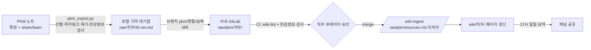

# 전사 LLM 위키 거버넌스 (초안)

현재 사내 LLM 위키는 한 팀(음성봇) 위키로 시작했다. 이 문서는 그것을 **전사 공용**으로 넓힐 때 필요한 규칙과,
개인 PKM 의 지식을 그 위키로 보내는 길을 정한다. 기존 위키의 작성·인제스트 규칙(`CLAUDE.md`, `/wiki-ingest`)은
그대로 두고, 그 위에 **누가·무엇을·어디로·어떻게 승인하는가**만 얹는다.

## 1. 디렉터리 = 직무, 팀은 메타데이터

조직(팀·본부)은 개편 때마다 바뀌지만 직무(개발, 인프라 운영, 테스트, 기획…)는 거의 바뀌지 않는다.
그래서 **경로에는 직무만** 쓰고, 바뀌는 것은 전부 머리말 값으로 둔다.

```
wiki/
├── index.md              전사 허브 — 직무별 목차로 가는 링크만
├── 공통/                 전 직무가 읽는 것: 도메인 개념(콜센터·음성봇), 용어집, 사내 공통 절차
├── 개발/                 직무 폴더 안은 지금처럼 플랫. 분류는 머리말이 맡는다
├── 인프라-운영/
├── 품질-테스트/
├── 기획-PM/
├── 기술영업/
└── 고객지원/
raw/
├── sources.md            기존 소스 대장
├── 회의록/ 문서/          기존 원본 (불변)
└── pkm/<직무>/            개인 PKM 에서 온 기여본 (불변) + raw/pkm/sources.md 대장
```

| 머리말 | 뜻 | 바뀌면 |
|---|---|---|
| `job` | 직무 (= 폴더). `jobs.json` 어휘만 | 폴더 이동 MR — 드묾 |
| `project` | 고객사·사업 (기존 어휘 유지) | 값만 수정 |
| `type` | 개념·설계·가이드·트러블슈팅·회의록·리포트 (기존 유지) | 값만 수정 |
| `domain` / `modules` | 기술 영역 | 값만 수정 |
| ~~`team`~~ | **쓰지 않는다.** 조직 개편 때 전 페이지가 틀려진다 | — |

- 직무 목록(`jobs.json`)은 **초안**이다. 인사 직무 체계로 확정해야 한다(확인 필요).
- 한 페이지가 두 직무에 걸치면 **주 독자 직무 폴더 하나**에 두고 다른 직무 목차에서 링크한다. 복제하지 않는다(SSOT).
- 기존 vbot 페이지는 대부분 `개발/`, 서버 구성·운영 점검 류는 `인프라-운영/`, 회귀·성능 테스트 류는 `품질-테스트/` 로 간다.
  파일 이동 시 상대 링크가 깨지므로 일괄 이동 스크립트 + `wiki-lint` 로 한 번에 처리한다.

## 2. 무엇을 보내는가 — 선별 기준 5개

PKM 노트 중 아래를 **모두** 만족하는 것만 나간다. 1번만 사람이 판단하고 나머지는 `tools/pkm_export.py` 가 검사한다.

| # | 기준 | 판정 |
|---|---|---|
| 1 | **"다른 직무·다른 팀 동료가 이 노트만 읽고 나 없이 행동할 수 있나?"** 예 → 노트 tags 에 `share/team` | 사람 |
| 2 | 유형이 개념·가이드·결정·관찰·분석 (작업·프로젝트·원본·영역은 개인 진행 상황이라 제외) | 스크립트 |
| 3 | 확정 상태: 개념·가이드·분석 `stable`, 결정 `accepted`, 관찰 `recorded` (`draft`·`proposed` 는 검증 전) | 스크립트 |
| 4 | 직무가 정해짐: `job/<직무>` 태그 우선, 없으면 `domain` → 직무 매핑(`jobs.json`) | 스크립트 |
| 5 | 민감정보 없음: PKM 하네스의 `sensitive-patterns.json`(키·토큰·주민번호·카드·전화·이메일·사설 IP) + 로컬 `.blocklist` | 스크립트 |

1번 질문에서 **"아니오"가 되는 전형**: 특정 개인 일정·평가·감정, 한 저장소에서만 의미 있는 코드 설명(→ 그 저장소 `doc/`),
고객사 계약·금액·거래 정보, 아직 결론 안 난 추측.

## 3. 역할

| 역할 | 누구 | 하는 일 |
|---|---|---|
| 기여자 | 전 직원 (GitLab Developer) | PKM → 기여본 생성, `raw/pkm/<직무>/` 로 MR |
| 직무 큐레이터 | 직무별 GitLab 그룹 (`CODEOWNERS.example`) | 자기 직무 폴더 MR 승인, `/wiki-ingest` 실행, 분기별 stale 정리 |
| 위키 관리자 | 전사 1~2명 (Maintainer) | `CLAUDE.md`·어휘·CI·`공통/` 관리, 직무 신설·폐지 |

- 소유자는 **사람이 아니라 그룹**이다. 퇴사·이동 시 그룹 멤버만 바꾼다.
- `main` 은 보호 브랜치. 직접 push 는 위키 관리자뿐, 나머지는 MR.

## 4. 흐름



1. **내보내기** — `python3 -I tools/pkm_export.py <볼트> --contributor <핸들>`.
   같은 내용이면 다시 쓰지 않고, 노트를 고치면 새 리비전 파일을 만들고 대장 비고에 `대체:` 를 남긴다(raw 불변 규칙).
2. **MR** — 대기함의 새 파일과 대장 행을 사내 저장소 `raw/pkm/` 로 옮겨 MR. 클론이 없으면 ONBOARDING 1-2 의 API 레시피
   (`"branch":"pkm/<핸들>/<날짜>","start_branch":"main"` + `POST merge_requests`) 그대로.
3. **승인** — 직무 큐레이터가 기준 1 을 다시 본다. CI 는 같은 민감정보 패턴을 서버에서 한 번 더 돈다(로컬 검사를 건너뛴 경우 대비).
4. **인제스트** — 큐레이터가 `/wiki-ingest`. 출처 표기는 `[PKM-<핸들>-<노트ID>-<리비전>]` — 순번이 아니라서 동시 MR 끼리 충돌하지 않는다.

## 5. 기존 위키에 필요한 변경 (위키 관리자 MR 1건)

| 파일 | 변경 |
|---|---|
| `.gitignore` | `!raw/pkm/` 와 `!raw/pkm/**/*.md` 추가 — 지금은 `raw/*` 가 막고 있어 기여본이 커밋되지 않는다 |
| `.claude/skills/wiki-ingest/SKILL.md` 1단계 | "`raw/pkm/sources.md` 의 `미처리` 도 대상" 한 줄 |
| `scripts/wiki-vocab.mjs` · `CLAUDE.md` | `job` 어휘 추가, `wiki/<직무>/` 한 단계 하위 폴더 허용 (현재 "하위 폴더 없음" 규칙 수정) |
| `.gitlab-ci.yml` | MR 파이프라인에 민감정보 검사 job 추가 (규칙은 PKM `sensitive-patterns.json` 과 같은 것) |
| `.gitlab/CODEOWNERS` | `CODEOWNERS.example` 반영 |

## 6. 지켜야 할 것

- **읽기 권한은 저장소 단위다.** Git 은 파일별 열람 제한이 없다. 특정 팀만 봐야 하는 내용은 전사 위키에 넣지 않는다.
- 민감정보·고객 비공개 정보·금액·계약·개인 평가는 원본에 있어도 옮기지 않는다 (기존 절대 규칙 + 회사 콘텐츠 정책).
- **이 개인 저장소(GitHub, 공개)에는 도구와 규칙만 둔다.** 내보낸 본문·대장은 `.gitignore` 로 막혀 있고 사내 GitLab 로만 옮긴다.
- 페이지는 지우지 않고 `status: stale`. `updated` 가 180일 넘은 `stable` 페이지는 주간 lint 리포트에 stale 후보로 올린다(제안).
- 모순은 덮어쓰지 않고 병기 — 기존 규칙 그대로.
